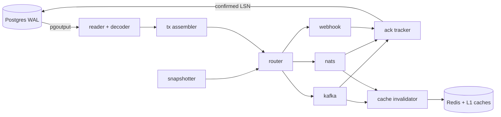

# Wake

Wake streams every change in Postgres to Kafka, NATS or webhooks in commit order, without losing or reordering events, and ships a two-level cache that invalidates itself from those changes.

**Status:** v0.1.0, the first release. Before 1.0, a minor release may change the configuration,
the Go API of `pkg/cache` and `pkg/event`, and the CLI; every change is listed in the
[changelog](CHANGELOG.md). Wake follows Semantic Versioning: a patch release only fixes bugs, the
CDC event format is versioned on its own (`api/schema/*.v1.json`, fields are only added within
v1), and error codes are never reused for a different condition.

[](https://github.com/thnhdatle/wake/actions/workflows/ci.yml)
[](https://goreportcard.com/report/github.com/thnhdatle/wake)
[](https://github.com/thnhdatle/wake/releases)
[](LICENSE)

## Why it exists

Applications need to react to data changes: invalidate caches, update search
indexes, publish domain events. Polling misses changes, triggers slow writes and
dual writes drift. Log-based change data capture is the right approach, but
Debezium runs on the JVM, usually inside Kafka Connect, and home-grown WAL readers tend to lose
events on restart or during the initial snapshot. Wake is one static Go binary
that reads the Postgres logical replication stream, confirms WAL to Postgres only
after every sink holds the change, and comes with a Redis-backed cache library
that stays correct when data changes outside the application.

## Quickstart

Requires Docker with Compose v2. From a clone of this repository (the compose
Postgres creates a `users` table on first start):

```bash
docker compose -f deploy/docker-compose.yml up -d --wait
docker compose -f deploy/docker-compose.yml exec postgres psql -U postgres -d app -c "INSERT INTO users VALUES (1, 'a@example.com')"
docker compose -f deploy/docker-compose.yml exec kafka /opt/kafka/bin/kafka-console-consumer.sh --bootstrap-server kafka:29092 --topic cdc.public.users --from-beginning --max-messages 1
```

The first `up` builds the Wake image from source. To run the released image instead,
`docker pull ghcr.io/thnhdatle/wake:v0.1.0` and
`export RAYLD_WAKE_IMAGE=ghcr.io/thnhdatle/wake:v0.1.0` before `up`. The last command prints
the insert as a CDC event ([format](docs/guides/consuming-events.md)):

```json
{"id":"0/1A2B3C8-0","source":{"db":"app","schema":"public","table":"users"},"op":"c","ts_ms":1760600000000,"lsn":"0/1A2B3C8","tx_id":750,"key":{"id":1},"before":null,"after":{"id":1,"email":"a@example.com"},"schema_version":1}
```

`docker compose -f deploy/docker-compose.yml down -v` removes everything.

## Install

The `wake` service, one of:

```sh
docker run --rm ghcr.io/thnhdatle/wake:v0.1.0 version
go install github.com/thnhdatle/wake/cmd/wake@v0.1.0
```

or a `wake_0.1.0_<os>_<arch>.tar.gz` archive for Linux or macOS (amd64, arm64) from the
[releases page](https://github.com/thnhdatle/wake/releases), checked against `checksums.txt`
(each archive has an SPDX SBOM). The binary is static. Then follow
[getting started](docs/guides/getting-started.md) to prepare Postgres and write a configuration.

The cache library and the event types (Go 1.27+):

```sh
go get github.com/thnhdatle/wake@v0.1.0
```

```go
users, err := cache.New[User]("users", cache.JSONCodec[User](),
	cache.WithL2(rdb), // a go-redis UniversalClient; without it the cache is L1 only
	cache.WithTTL(10*time.Minute, time.Minute))
if err != nil {
	return err
}
defer users.Close()

u, err := users.GetOrLoad(ctx, "user:42", func(ctx context.Context) (User, error) {
	return loadUser(ctx, 42) // read from the primary database
})
```

`wake cache-invalidator` (or `pkg/cache/cdcsource` in your own process) deletes the keys of
changed rows from the event stream; see the [cache guide](docs/guides/cache.md). `pkg/event`
decodes and validates events for consumers written in Go.

## Architecture



Wake reads one logical replication slot with the built-in `pgoutput` plugin,
assembles each transaction and releases it at commit. The router sends every
event to the sinks whose table globs match, partitioned by the canonical key so
that per-key order holds. The ack tracker reports to Postgres only the end of
the contiguous prefix of transactions that every sink acknowledged, so a crash
replays instead of losing. Snapshots of existing rows (initial and for tables
added later) are interleaved with the stream through watermarks without pausing
it. The `pkg/cache` library combines an in-process L1 with Redis, guarded by
per-key generations, and `wake cache-invalidator` deletes keys from the change
stream.

## Features

- **Capture**: Postgres 14–17, managed or existing publications, partitioned tables through their root, keyless tables opt-in — [getting started](docs/guides/getting-started.md)
- **Delivery guarantees**: at-least-once, commit order per key, crash-safe confirmed LSN, backpressure instead of dropping — [delivery guarantees](docs/guides/delivery-guarantees.md)
- **Snapshots**: consistent initial snapshot, resumable after a crash, on-demand and added-table snapshots via watermarks — [operations](docs/guides/operations.md)
- **Sinks**: Kafka (idempotent producer, tombstones), NATS JetStream (deduplication by id), signed webhooks with lanes and opt-in dead-letter directory, stdout — [sinks](docs/guides/sinks.md)
- **Schema changes**: per-table schema versions and schema-change events — [schema changes](docs/guides/schema-changes.md)
- **Operations**: slot lag and ack-age alerts, heartbeats on idle sources, `wake check`, `wake status`, Prometheus metrics — [operations](docs/guides/operations.md)
- **Cache library**: L1 + Redis with stampede protection, stale-if-error, Redis outage handling, CDC-driven invalidation — [cache](docs/guides/cache.md)
- **Event contract**: JSON Schema and Go types in `pkg/event` — [consuming events](docs/guides/consuming-events.md), [type mapping](docs/guides/type-mapping.md)

## Benchmarks

Wake v0.1.0 pre-release build on a MacBook Pro M3 Pro 36 GB, macOS 26.1, Docker Desktop VM
8 CPU / 10 GB, Go 1.27.2; Wake runs natively on the host against the compose Postgres, Kafka
and Redis. Full method and per-run values: [bench/RESULTS.md](bench/RESULTS.md).

| Scenario | Target | Measured |
|---|---|---|
| Postgres → Kafka throughput, single-row inserts offered at 5,000 tx/s, 120 s window, median of 3 runs | ≥ 5,000 events/s, commit→ack p99 < 200 ms | 4,999.7 events/s (**target not met**, see below), p99 12 ms |
| CDC invalidation latency, commit → key gone from L1 on 3 instances, 100 updates/s for 120 s (12,000 updates), one run | p99 < 500 ms | p99 18.5 ms |
| `Cache.Get` L1 hit, one goroutine, 64-byte value, no L2, median of 3 runs | < 200 ns/op, 0 allocs/op | 55.8 ns/op, 0 allocs/op |

Throughput: in this run the offered load (5,000 tx/s, one event each) was equal to the target,
so Wake acked within a few dozen events of 600,000 in every 120 s window (4,999.45 to
5,000.05 events/s) and confirmed the final LSN about 0.2 s after the load stopped: it kept up
with no backlog. The stated target of at least 5,000 events/s was nevertheless missed by the
median, and headroom above 5,000 events/s was not measured.

Correctness under failures (`kill -9` during large transactions, sink and Redis outages,
schema changes, snapshots under write load) is checked by the
[acceptance suite](acceptance/README.md) rather than benchmarked; see the
[report](acceptance/report.md).

## Configuration

Every option is documented in [docs/guides/configuration.md](docs/guides/configuration.md)
and [deploy/config.example.yaml](deploy/config.example.yaml). The most used:

| Key | Default | Meaning |
|---|---|---|
| `source.name` | (required) | names the slot and publication `wake_<name>` |
| `tables.include` | (required in managed mode) | globs of `<schema>.<table>` to capture |
| `sinks` | (required) | list of `kafka`, `nats`, `webhook`, `stdout` sinks with table globs |
| `snapshot.mode` | `initial` | snapshot existing rows on first start (`never` to skip) |
| `lag.critical_bytes` | `10GiB` | slot-lag alert threshold |

## Known limitations

- Postgres → Kafka throughput: the ≥ 5,000 events/s target was not met in the v0.1.0
  measurement (4,999.7 events/s at an offered 5,000 tx/s, see [Benchmarks](#benchmarks)); the
  maximum throughput was not measured.
- One consumer per replication slot: one Wake instance per source, no automatic failover, and a
  stuck sink holds back every sink of that instance.
- Delivery is at least once: consumers deduplicate by `id` or upsert by key.
- Transactions are delivered only after they commit; a very large transaction is spilled to
  disk (`stream.spill_dir`) until then.
- The admin HTTP endpoints have no authentication; keep them on a private address
  ([admin endpoints](docs/guides/operations.md#admin-endpoints)). Report vulnerabilities as
  described in [SECURITY.md](SECURITY.md).
- `wake version` of a binary built with `go install` prints `dev`; release archives and images
  carry the version.

## When not to use it

- You need exactly-once delivery into a transactional target: Wake is
  at-least-once; consumers deduplicate by `id` or upsert by key.
- You run many sources or need Kafka Connect's connector ecosystem: Debezium fits
  better.
- You need high availability with automatic failover between Wake instances:
  v0.1 runs one consumer per slot.
- Your source is not Postgres 14 or newer.

## Roadmap

See [ROADMAP.md](ROADMAP.md).

## Contributing

See [CONTRIBUTING.md](CONTRIBUTING.md). Wake is licensed under the
[Apache License 2.0](LICENSE).
